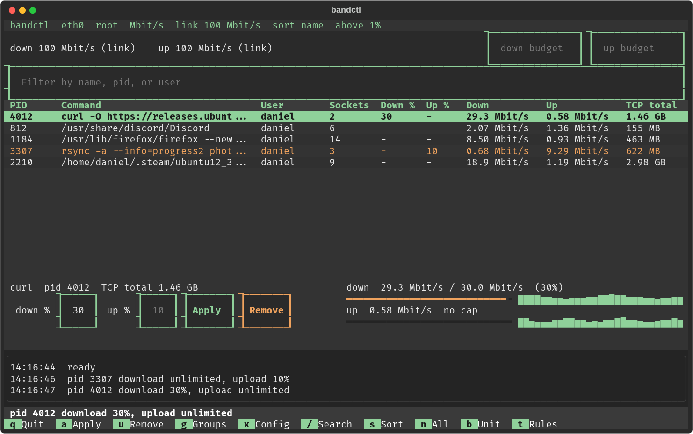
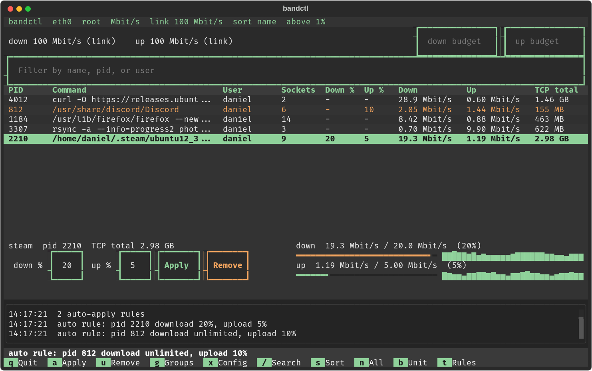
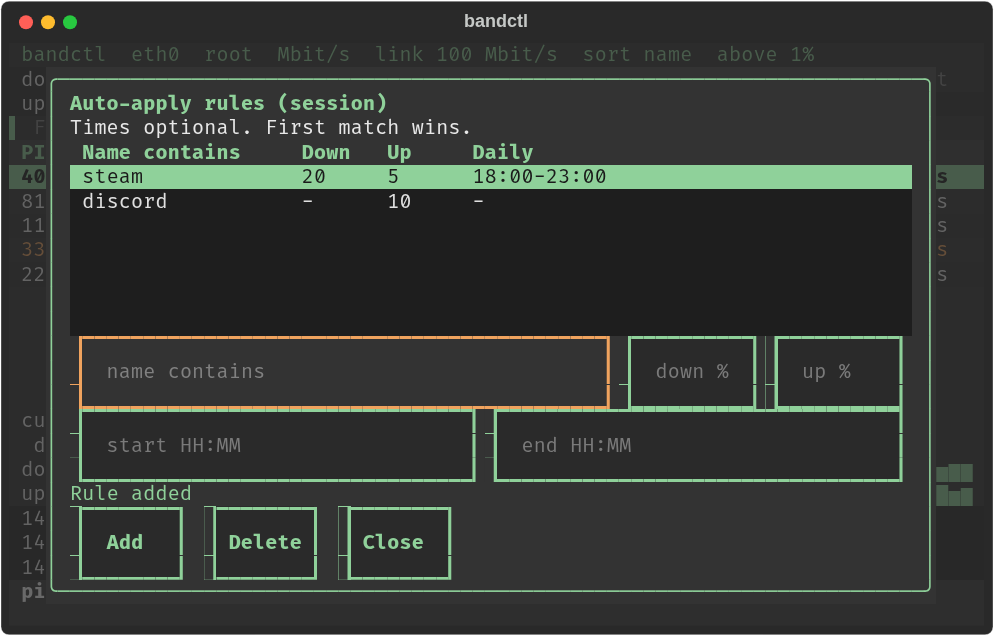
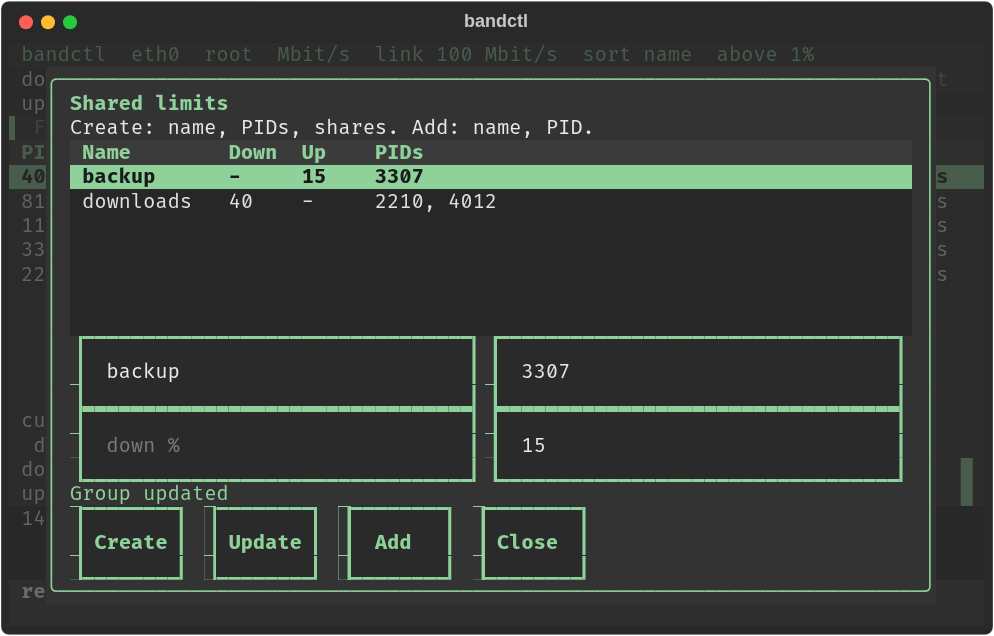
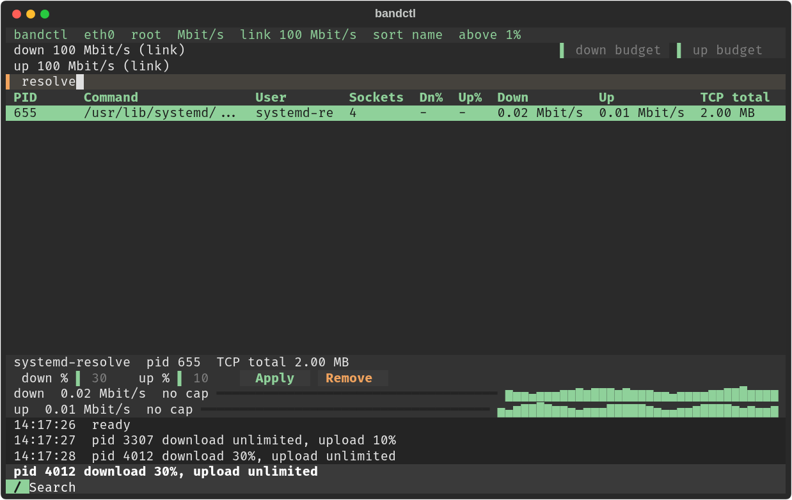
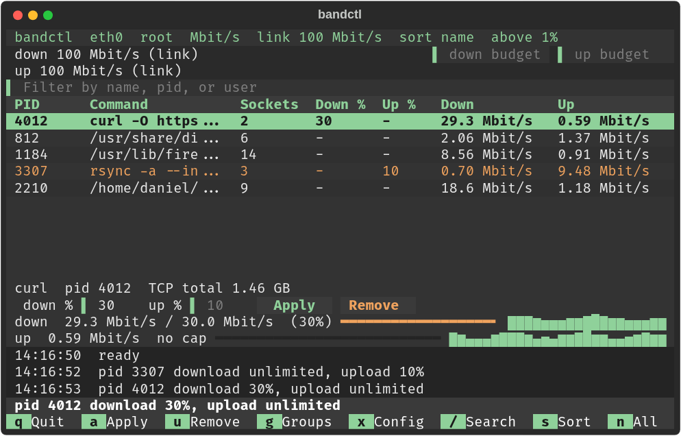
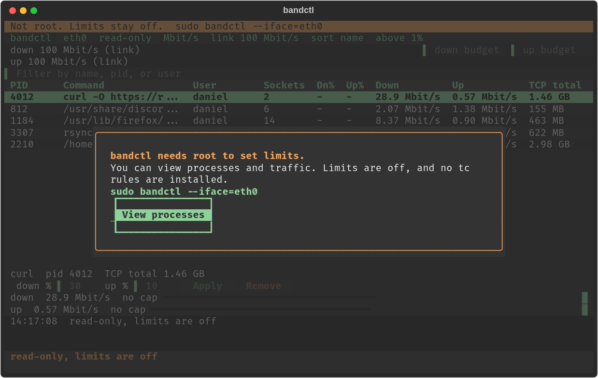

# bandctl

[](https://github.com/DanielMellen-University/bandctl/actions/workflows/ci.yml)


[](LICENSE)

**Per-process bandwidth limits on Linux, from a terminal UI or a single command.**

Pick a running process, give it a download and an upload percent, and it cannot go past that ceiling while bandctl runs. Under the hood it is a cgroup, a few nftables rules, and an HTB qdisc. Quit, and all of it is removed again.



## Features

- **Separate download and upload caps** per process, as a percent of link speed or of a budget you type.
- **Live view** of each process's TCP rates, a one-minute graph per direction, and an estimated session total.
- **Auto-apply rules** that cap matching processes as they appear, optionally only inside a daily time window (say, `steam` from 18:00 to 23:00).
- **Shared limits**: put several processes in a named group that shares one ceiling.
- **Search** by name, command line, PID, or user, including idle processes.
- **Settings import and export** as validated JSON, plus `--config` to start with saved budgets and rules.
- **A non-interactive CLI** for every action (`sudo bandctl limit firefox --down 30`), backed by a background session.
- **Clean exit and crash recovery**: quitting restores every process and qdisc it touched, and a recovery file lets the next start finish the job after a crash.
- **Works at any terminal size** from 60x18 up, and still opens read-only without root.

## Quick start

```
curl -fsSL https://raw.githubusercontent.com/DanielMellen-University/bandctl/main/install.sh | sudo bash
sudo bandctl
```

From a git checkout, `sudo ./install.sh` does the same. The installer adds `python3`, `iproute2`, and `nftables` if they are missing, installs into `/opt/bandctl`, and links `bandctl` onto `PATH`. Pick an interface with `sudo bandctl --iface wlan0`; the default is the device on the IPv4 default route.

In the TUI:

| Key | Action |
| --- | --- |
| Up/Down, click | Select a process |
| Enter, `a` | Apply the percent fields |
| `u` | Remove the limit |
| `/` | Search |
| `t` | Auto-apply rules |
| `g` | Shared limits |
| `x` | Import or export settings |
| `b` | Toggle Mbit/s and MB/s |
| `q` | Quit and remove every limit |

From a script or another terminal:

```
bandctl list                                  # processes, no root needed
sudo bandctl limit firefox --down 30 --up 10  # starts a background session
sudo bandctl remove firefox
sudo bandctl export settings.json
sudo bandctl stop                             # removes every limit and exits
```

Add `--json` to any command for machine-readable output. The full guide is in [docs/USAGE.md](docs/USAGE.md).

## How it works

```
process ──► cgroup bandctl/bandctl-<pid>
               │
               ▼
  nftables  inet bandctl: socket cgroupv2 match ─► ct mark + meta mark = <minor>
               │                                         │
     upload    ▼                               download  ▼
  HTB on the interface, class 1:<minor>     ingress ─► ctinfo copies the mark
                                            ─► mirred to ifb-bandctl
                                            ─► HTB class 1:<minor>
```

1. The process moves into its own cgroup v2 leaf.
2. An nftables rule matches that cgroup and stamps a mark on the connection.
3. Upload traffic hits an HTB class on the real interface. Download traffic is redirected through an IFB device with its own HTB tree, because ingress runs before netfilter.
4. Sockets that were already open keep their old cgroup, so each one also gets a `flower` filter by address and port, refreshed about once a second.

Every change is written to `/run/bandctl.json` first, and exit cleanup restores the original cgroups and root qdisc. [docs/ARCHITECTURE.md](docs/ARCHITECTURE.md) has the exact commands and the failure handling.

## Screenshots

| | |
| --- | --- |
|  Auto-apply rules at 19:30: `steam` is inside its 18:00 to 23:00 window, `discord` is capped all day. |  The rule editor. |
|  Shared limits: `curl` and `steam` share one 40% download ceiling. |  Search finds the idle `systemd-resolved` below the 1% cutoff. |
|  A standard 80x24 terminal. |  Without root, it opens read-only and shows the command to run. |

More sizes and the settings screens are in [docs/USAGE.md](docs/USAGE.md#screenshots). Every screenshot is rendered headlessly from fake data by [tools/screenshots.py](tools/screenshots.py).

## Requirements

- Linux with cgroup v2 (any current systemd distro)
- Root, to move processes between cgroups and change qdiscs
- `iproute2` (`tc`, `ip`, `ss`), `nftables`, and the `ifb` kernel module
- Python 3.10 or newer and Textual (the installer handles both)

## Limitations

These are deliberate scope choices for this release.

- **Limits last only while bandctl runs.** Shares, groups, and rules are not saved across runs. Export settings and start with `--config` to bring budgets and rules back.
- **Rates and totals count TCP only.** UDP traffic is shaped but not shown in the rate columns, graphs, or totals.
- **Root is required to set limits.** Without root, bandctl is a read-only process and traffic viewer.
- **An upload limit replaces the interface's root qdisc.** Cleanup adds back the previous qdisc kind with default settings, but not custom options, child qdiscs, classes, or filters. bandctl will not replace an existing `htb` root, and a download limit will not share an interface with an existing ingress qdisc. Use an interface where losing custom qdisc settings is fine.
- **One shaping session at a time.** The TUI and the CLI session cannot both control shaping.
- **Brand-new inbound connections** are shaped from the process's first reply onward, not from the very first packet.
- **Wildcard-bound UDP sockets** that were already open are not matched by default. `--match-wildcard` matches them by port, which can also catch other processes on that port.

Ideas that would lift these limits (persistent rules, UDP accounting, eBPF enforcement) need a design decision first; see [CONTRIBUTING.md](CONTRIBUTING.md).

## Testing

```
python3 -m venv .venv
.venv/bin/pip install -r requirements.txt
.venv/bin/python -m unittest discover -s tests -v
```

633 unit tests run without root, `tc`, or a network namespace. They cover the HTB rate math, the exact command plan against a fake host, crash recovery, the CLI session over a real local socket, and a headless Textual pass over the UI at a dozen terminal sizes. CI runs them on Python 3.10 and 3.12 and does a full install and uninstall under a temp prefix. A manual check with a real download is in [docs/TESTING.md](docs/TESTING.md).

## Uninstall

Quit bandctl first (`q` removes the limits), then:

```
sudo bandctl-uninstall
```

It removes the installed virtual environment, scripts, and command, and clears any qdisc, nft table, or cgroup left by a crashed run. It leaves `iproute2` and `nftables` installed.

## Run from a checkout

```
python3 -m venv .venv
.venv/bin/pip install -r requirements.txt
sudo .venv/bin/python -m bandctl
```

Name the venv interpreter. `sudo python` is often a different install and will not see Textual.

## Project layout

```
bandctl/
  __main__.py         entry point and argument parsing
  app.py              Textual screens, keys, and the 1 second refresh
  widgets.py          the not-root dialog and the rule editor
  group_screen.py     the shared-limit editor
  settings_screen.py  settings import and export screen
  theme.tcss          dark grey, pastel green, orange
  shaper.py           cgroup, nft, tc, and crash recovery
  rates.py            percents, units, and the HTB rate split
  iface.py            default route and link speed
  procscan.py         /proc process list and socket owners
  traffic.py          per-process TCP rates and totals from ss
  history.py          one-minute rate history behind the graphs
  rules.py            auto-apply rule matching and ownership
  schedule.py         daily HH:MM windows for rules
  groups.py           shared-limit validation and view
  settings.py         settings file format and validation
  settings_session.py session import and export
  session_lock.py     one shaping session at a time
  text.py             safe terminal text
  cli.py              non-interactive commands
  cli_client.py       find or start the background session
  cli_worker.py       the background session process
  cli_transport.py    private local socket for CLI requests
  cli_protocol.py     request validation and dispatch
  cli_session.py      CLI session and rule reconciliation
install.sh            system install
uninstall.sh          remove that install
tests/                unittest suite, no root required
tools/screenshots.py  regenerates docs/screenshots
docs/                 usage, architecture, testing
```

## Docs

- [Usage](docs/USAGE.md): every screen, key, and command in detail
- [Architecture](docs/ARCHITECTURE.md): cgroup, nft, HTB, IFB, and the recovery file
- [Testing](docs/TESTING.md): the unit suite and a manual check that needs root
- [Changelog](CHANGELOG.md)
- [Contributing](CONTRIBUTING.md)

## License

MIT. See [LICENSE](LICENSE).
