# bandctl

Terminal UI for per-process bandwidth shares on Linux.

Pick a running process and give it a download percent and an upload percent. Each percent is a ceiling on that direction's link capacity: 30% of a 100 Mbit/s link is 30 Mbit/s, and the process cannot go past it while bandctl is running. Under the UI this is a cgroup, nftables marks, and an HTB qdisc. Quit, and those rules are removed.

Version 0.1.0. Download and upload are capped separately. Each process has a one-minute graph of its download and upload rates and an estimated count of the TCP data it has moved since bandctl started. Auto-apply rules put a limit on matching processes as they show up, optionally only during a daily time window. `/` searches the process list by name, pid, or user. Rates can be shown in bits or bytes, the table sorts by measured usage, and a log shows any tc, nft, or cgroup errors. Named groups share one ceiling, and settings can be exported and imported as JSON. Every action is also available as a non-interactive command, such as `sudo bandctl limit firefox --down 30`. Shares, groups, and rules are not saved across runs.

## Layout

```
bandctl/
  __main__.py    python -m bandctl
  cli.py         non-interactive commands
  cli_client.py   find or start the background session
  cli_protocol.py CLI request validation and dispatch
  cli_session.py  CLI session and rule reconciliation
  cli_transport.py  private local socket for CLI requests
  cli_worker.py   background shaping session
  session_lock.py exclusive lock for shaping state
  app.py         Textual screens, keys, and the 1 second refresh
  widgets.py     the not-root dialog and the rule editor
  group_screen.py  the shared-limit editor
  settings_screen.py  explicit settings import and export
  settings.py    settings format and validation
  settings_session.py  session import and export
  groups.py      group validation and active group view
  history.py     the one-minute rate history behind the graphs
  rules.py       auto-apply rule matching and ownership
  schedule.py    daily HH:MM windows for rules
  theme.tcss     dark grey, pastel green, orange
  procscan.py    /proc process list and socket counts
  traffic.py     per-process TCP rates and session totals from ss
  rates.py       percents, units, HTB split
  iface.py       default route and link speed
  shaper.py      cgroup, nft, tc
install.sh       system install
uninstall.sh     remove that install
tests/           unittest, no root required
docs/            usage, architecture, testing
```

## Install

The installer installs `python3`, `iproute2`, and `nftables` if they are missing, puts bandctl in `/opt/bandctl`, and links `bandctl` onto `PATH`.

```
curl -fsSL https://raw.githubusercontent.com/DanielMellen-University/bandctl/main/install.sh | sudo bash
```

From a git checkout:

```
sudo ./install.sh
```

Then:

```
sudo bandctl
sudo bandctl --iface wlan0
```

bandctl has to be root to move processes between cgroups and to change qdiscs. Only one root bandctl session can control shaping at a time. The installer is what makes `sudo bandctl` find Textual. `sudo python -m bandctl` often does not.

Without root the UI still opens. It lists processes and tells you the exact command to re-run. Apply and remove stay disabled, and nothing is installed on the interface.

## Uninstall

Quit bandctl first if it is open. `q` removes the limits. Then:

```
sudo bandctl-uninstall
```

That deletes `/opt/bandctl` and the `bandctl` command. If the last run crashed, it also clears the qdisc, nft table, and cgroup that run left behind. It does not remove `iproute2` or `nftables`.

## Run from a checkout

Skip the installer when you are working on the code. Debian and Ubuntu need the `python3-venv` package before `venv` will work.

```
python3 -m venv .venv
.venv/bin/pip install -r requirements.txt
sudo .venv/bin/python -m bandctl
```

Name the venv interpreter. `sudo python` is often a different install and will not see Textual.

`--iface` overrides the device on the IPv4 default route. bandctl checks that the device exists before it starts. A typo stops with an error that lists the interfaces it found. There is no interface switch inside the UI. Quit and start again with the flag.

## Usage

The window needs at least 60 columns and 18 rows. Below that, bandctl asks you to make the terminal bigger. The layout changes with the window size:

| Size | Layout |
| --- | --- |
| 108 columns or more | Meters sit beside the percent fields. |
| Under 108 columns | Meters sit under the percent fields. |
| Under 80 columns | Shorter header and a tighter footer. The TCP total, user, and socket columns go first when space runs out. |
| Under 32 rows | Inputs and buttons take one row each, with a colored edge instead of a box, so the table keeps more rows. |
| Under 22 rows | The log shows two lines. |
| 42 rows or more | The log shows more lines. |

The process table always fits the width instead of scrolling sideways. When space is tight, the percent headers become `Dn%` and `Up%`. The table, the percent fields, the meters, the log, and the status line stay on screen at every supported size.

The table lists processes using more than 1% of the link. When the link speed is unknown, that 1% is of the TCP traffic measured right now, ignoring loopback. `n` lists every process. A process that already has a share stays on screen so you can remove it. Type `/` to filter by name, pid, or user. A search looks through every process, including idle ones under 1%. Esc goes back to the table. Select a row with the arrow keys or a click.

Type a download percent, an upload percent, or both (1 to 100). Leave a field blank to leave that direction uncapped. Enter in a percent field, the Apply button, or `a` installs the share. `u` removes it. Limited rows are orange, except the selected row, which stays green so the text stays readable. The bar is green while usage is under the ceiling and orange when it is at the cap.

Apply verifies the selected process start time. If the process has exited, its PID was reused, or its start time cannot be read, rescan and try again.

Beside each bar, a small graph shows the selected process's last 60 seconds of download or upload rates. The newest sample is on the right. Each graph scales to its own highest rate in that window. At narrow widths, each character covers several seconds and shows the highest rate in that span. Blank spaces indicate spans with no samples.

`TCP total` is the selected process's estimated download plus upload bytes since bandctl started. A table column shows the total when there is room. The count uses bytes even when rates use bits per second. It covers observed TCP sockets, not UDP or loopback. Short-lived or unreported sockets can be missed, and bytes already transferred on a socket first seen after startup can be included. Shared sockets count for each listed owner. Treat the total as an estimate.

The header shows the interface, whether this process is root, and the active unit (`Mbit/s` or `MB/s`). `b` toggles the unit. Percents stay percents. Budgets and the usage numbers follow the toggle.

If sysfs has no positive link speed (common on Wi-Fi), the capacity line says unset. Type a budget in the down and up fields. Apply uses that number, and so does Enter in the budget field. The number is in the unit currently shown: `100` in Mbit/s is 100 Mbit/s, and the same digits in MB/s are 100 megabytes per second. An empty budget means "use the detected speed".

Keys:

| Key | Action |
| --- | --- |
| Up/Down, click | Select a process |
| `/` | Filter the table |
| Enter, `a`, Apply | Apply both percent fields |
| `u`, Remove | Remove the share |
| `r` | Rescan processes |
| `n` | Show every process, or go back to processes above 1% |
| `s` | Cycle sort: name, pid, download, upload |
| `b` | Toggle Mbit/s and MB/s |
| `t` | Edit auto-apply rules |
| `g` | Edit shared limits |
| `x` | Import or export settings |
| `q` | Quit and remove every rule this process installed |

The log under the bars keeps the last successes and failures. A failed `tc`, `nft`, or cgroup write is one line there and in the status bar. bandctl tries to restore the previous share when an update fails and reports an incomplete rollback if that also fails. A brand new share is rolled back, and the empty cgroup made for it is removed. If the process cannot be restored, the error reports an incomplete rollback and the share stays listed so you can try Remove. Its ceiling may not be active. If Remove cannot put a running process back in its old cgroup, the share stays listed so you can try again. A process that has already exited is dropped.

If restoring a process or the root qdisc, removing the download redirect, or deleting the nftables table fails, bandctl reports the error and keeps the recovery file. Remove can retry while the session is open; after exit, the next start retries recovery.

Press `t` to add or delete auto-apply rules. Enter part of a process name and a download percent, an upload percent, or both, then press Enter or Add. Optionally enter daily start and end times in `HH:MM`. The limit is removed when the window ends. Matching ignores case, and the first active matching rule wins. Rules need root, like Apply. Rules apply to matching running processes and new processes while bandctl is open. Existing limits are left alone. A manual change takes precedence for that process instance. Rules are kept for this session only and are cleared on exit. The log reports failures and retries them after 15 seconds.

Press `g` to create a named shared limit. Enter a name, comma-separated PIDs, and one or both percentages, then choose Create. The processes must be running and have no existing limit. Their combined traffic shares one ceiling in each direction. Select a group row to fill its name and percentages, then choose Update to change its limits. To add a process, enter its PID and choose Add. Use Remove on the main screen to remove one member; the group ends when its last member is removed. Group members show the group name in the detail line. The bars show the selected process's rate against the shared ceiling, not the combined group rate. Groups last for the session only.

Press `x` to import or export settings as JSON. Export includes the interface, submitted budgets, auto-apply rules and schedules, and groups. It replaces the chosen file and makes it readable only by its owner. Import checks the entire file before applying it. It replaces the current rules, budgets, and groups, while leaving individual limits in place. An imported group cannot use a PID that already has an individual limit. Group members must still be the same running processes on the same boot. The file's interface must match the interface bandctl is using. To select the saved interface at startup, run `sudo bandctl --config settings.json`. Rules and groups are loaded only when you choose Import.

Full steps and the manual check with a real download are in [docs/USAGE.md](docs/USAGE.md) and [docs/TESTING.md](docs/TESTING.md).

## Command line

`bandctl list` lists running processes without opening the TUI. Add `--json` for machine-readable output. The list does not include command-line arguments. Limits use the same 1 to 100 percentages as the TUI:

```
sudo bandctl limit firefox --down 30 --up 10
sudo bandctl remove firefox
sudo bandctl export settings.json
sudo bandctl import settings.json
sudo bandctl stop
```

A name must match exactly and identify one process; use a PID when names are ambiguous. Put `--iface` before the command to choose an interface. Limit and import start a background session if one is not already running. The session keeps limits and scheduled rules active after the command exits. `stop` removes its limits and waits for cleanup. The TUI and CLI cannot control shaping at the same time. Commands that change or export the session require root. Add `--json` to a command for machine-readable output. A later session command reports recent background errors, including interrupted refreshes. If link speed is unknown, import a settings file with submitted capacity budgets before setting a limit.

## What a share means

The ceiling is a percent of capacity, not of whatever the link happens to be doing this second. Capacity is the detected link speed, unless you typed a budget. Several shares may add up to more than 100%. Each process still cannot pass its own percent. The guaranteed HTB rates are scaled down so they fit, and the status line says so.

Rules exist only while bandctl is running. Exit restores each process to the cgroup it had before, deletes the nftables table `inet bandctl`, deletes `ifb-bandctl`, and puts the previous root qdisc back if bandctl replaced it. A qdisc bandctl never touched is left alone, even when another part of the cleanup fails. A crash writes `/run/bandctl.json`. The next start uses that file to finish the cleanup.

While an upload share is active, bandctl replaces the root qdisc on the chosen interface with HTB. Unmarked traffic can still use the full link. Do not point bandctl at an interface that already has an `htb` qdisc. It will refuse. A download share also requires that the interface has no existing ingress qdisc and that `ifb-bandctl` does not already exist.

bandctl creates its own nftables table named `inet bandctl`. It refuses to apply limits if that table already exists.

Existing connections are matched by address and port because moving a process does not move its existing sockets. The list is refreshed about once a second. An existing UDP socket bound to a wildcard address is not reliably matched by this filter.

## Docs

- [Usage](docs/USAGE.md)
- [Architecture](docs/ARCHITECTURE.md)
- [Testing](docs/TESTING.md)
- [Changelog](CHANGELOG.md)

## Contributing

See [CONTRIBUTING.md](CONTRIBUTING.md). Run the unit tests before pushing, and change the docs in the same commit as the behaviour they describe.

## License

MIT. See [LICENSE](LICENSE).

## Screenshots

A 120 by 36 terminal. `curl` has a 30% download share and is close to its cap. `rsync` has a 10% upload share, so its row is orange.

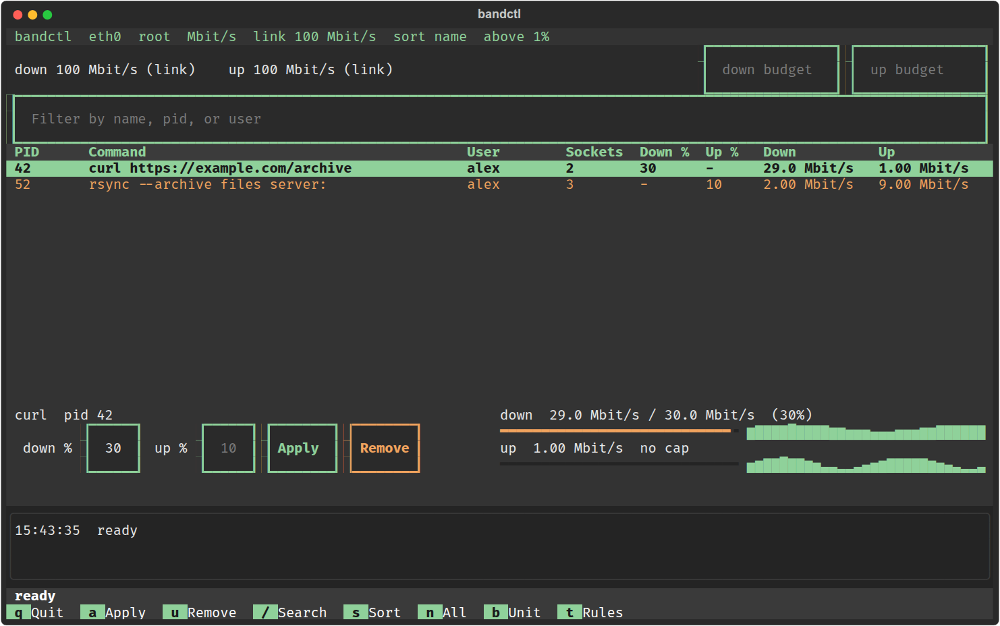

80 by 24. Under 32 rows the inputs and buttons take one row each, and each meter fits on one line.

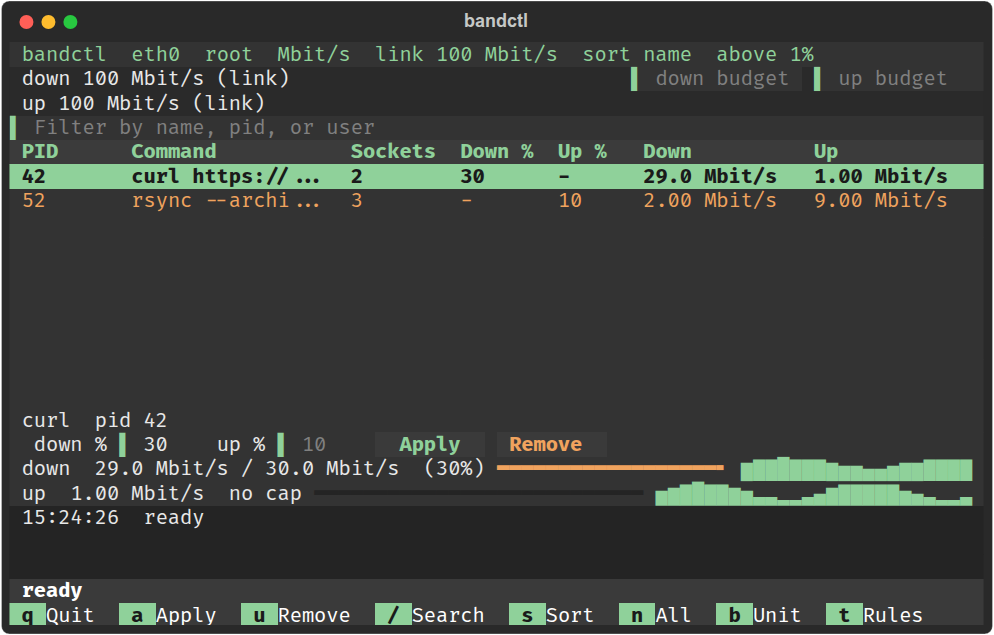

77 by 38. Narrow and tall. The meters sit under the percent fields and the column headers get shorter.

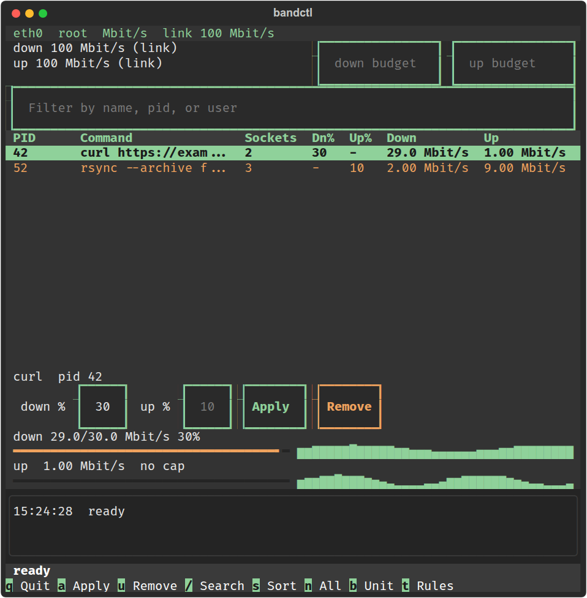

60 by 20, close to the smallest size bandctl supports.

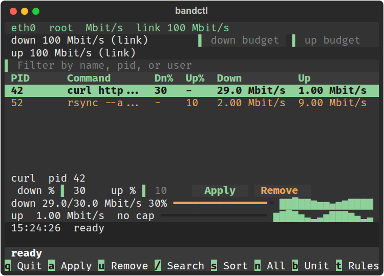

Started without root. The dialog shows the command to run instead, and Apply and Remove are off.

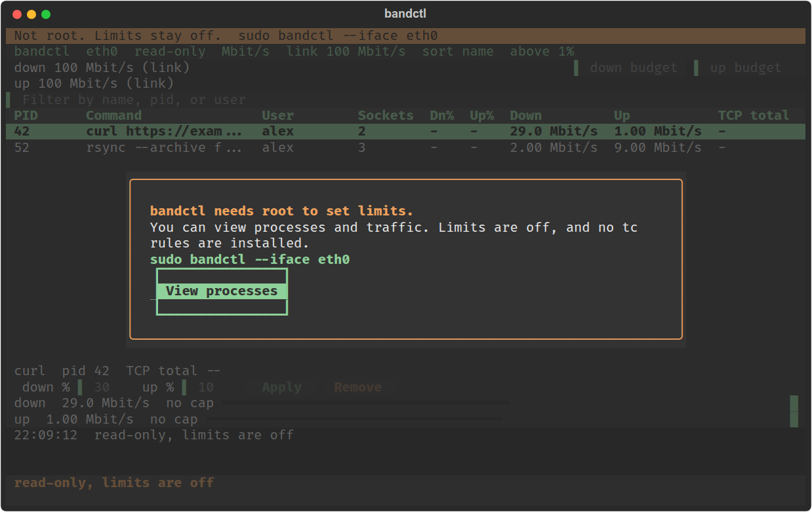

The auto-apply rule editor at 80 by 24.

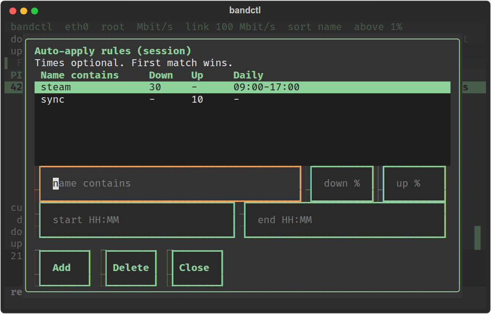

120 by 36 at 19:30 with two rules: `steam` gets 20% down and 5% up from 18:00 to 23:00, and `discord` gets 10% up all day. Both rows turned orange on their own, and the log says which rule did it.

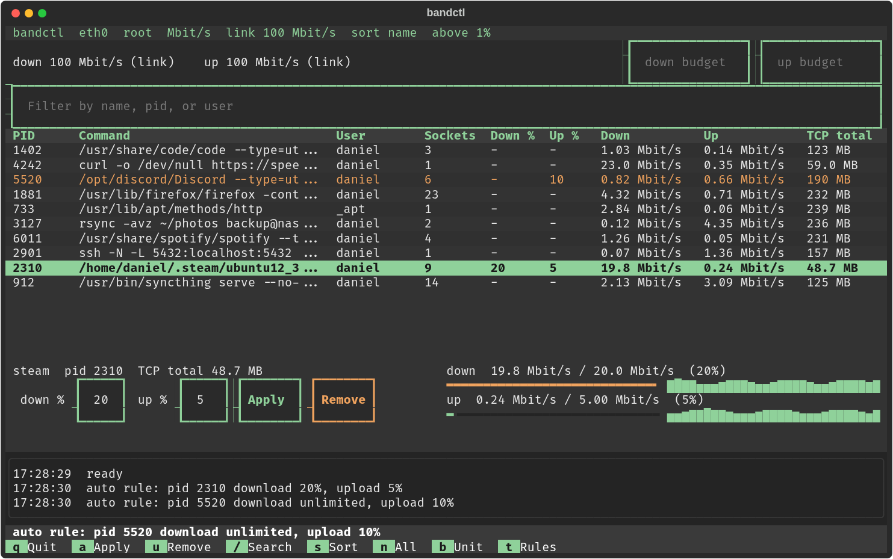

A search for `resolve` finds `systemd-resolved` even though it is idle and below the 1% cutoff.

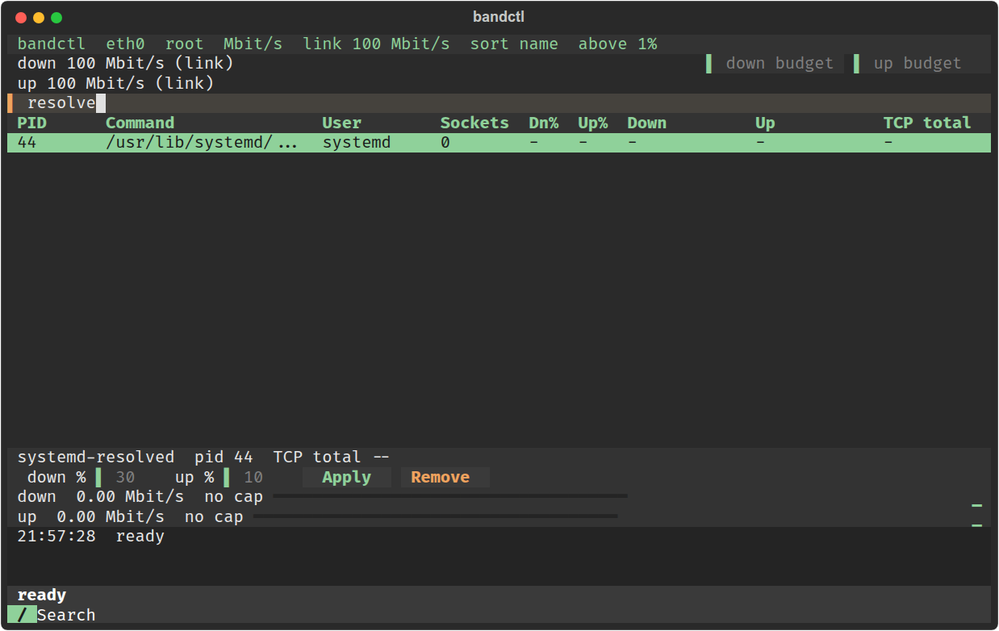

The shared-limit editor at 80 by 24.

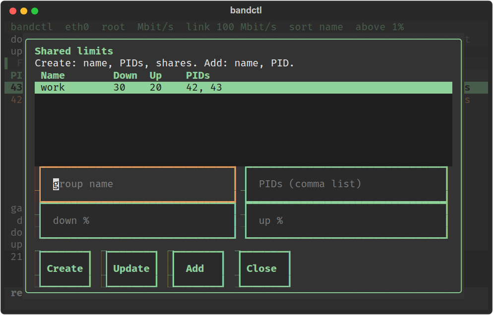

The settings file controls at 80 by 24.

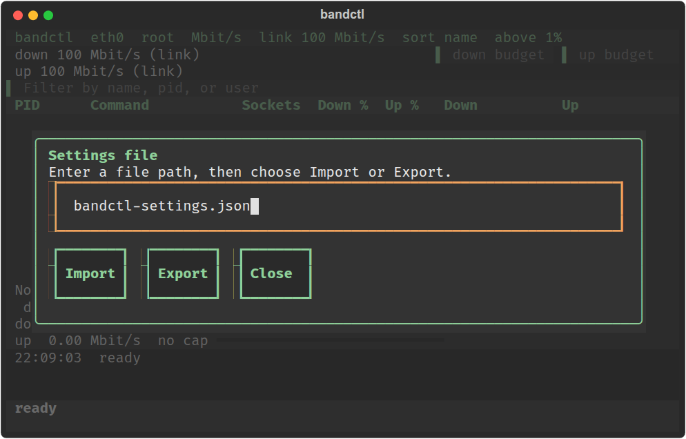

Started with `--config`, with the saved download budget applied.

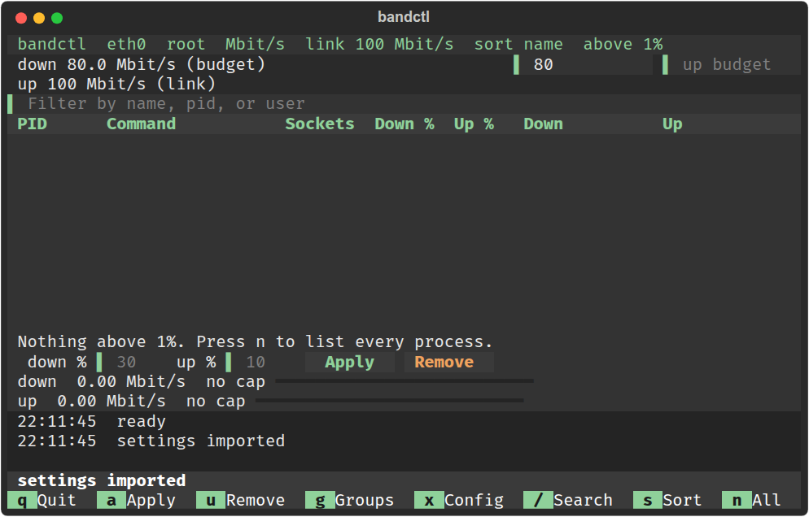
